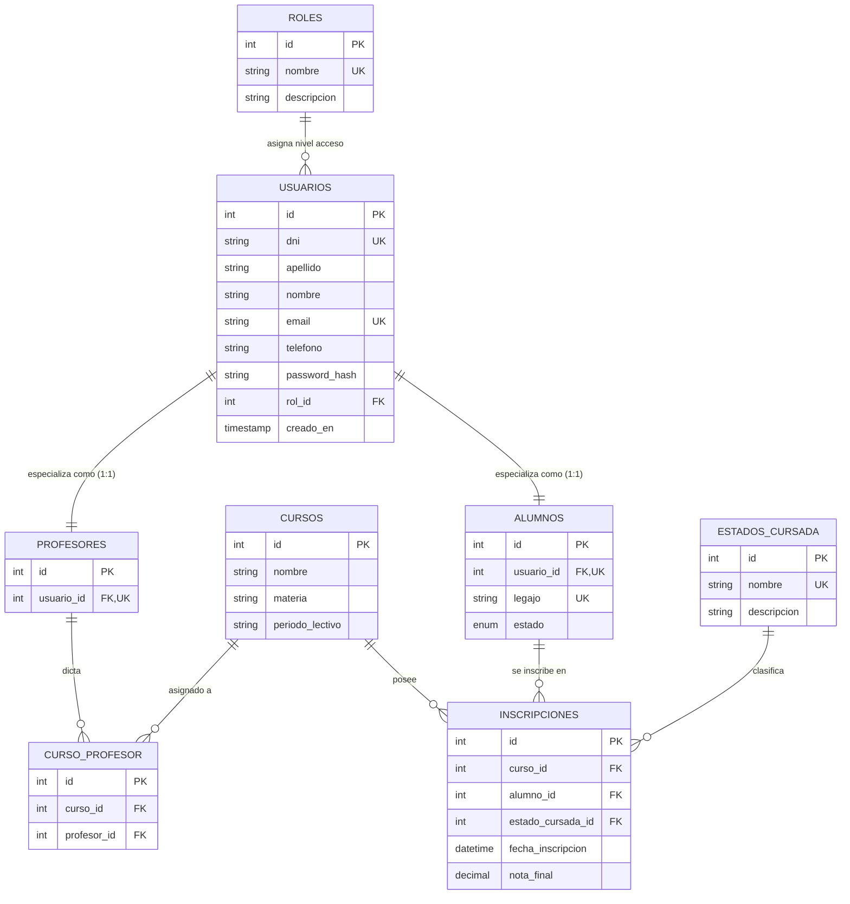

# 01. Modelo de Datos y Normalización (3FN)

## 📌 Introducción y Principios de Diseño

El esquema de base de datos del **Sistema de Gestión Académica** ha sido diseñado bajo los estándares más estrictos de ingeniería de bases de datos relacionales, garantizando la **Tercera Forma Normal (3FN)** y aplicando el patrón relacional **Supertipo / Subtipo (Generalización y Especialización)**.

### Patrón Supertipo / Subtipo

Para evitar la redundancia de datos personales (como `apellido`, `nombre`, `email` y `telefono`) entre estudiantes, profesores y administradores, se definió la tabla **`usuarios`** como la entidad base (*Supertipo*). Las tablas **`alumnos`** y **`profesores`** actúan como extensiones especializadas (*Subtipos*) vinculadas mediante una relación 1:1 estricta utilizando la clave foránea `usuario_id` con eliminación en cascada (`ON DELETE CASCADE`).

```text
               +----------------------------------+
               |             USUARIOS             |
               | (DNI, Nombre, Email, Pass, Rol)  |
               +----------------------------------+
                                 |
                 +---------------+---------------+
                 | (1:1)                         | (1:1)
                 v                               v
       +-------------------+           +-------------------+
       |      ALUMNOS      |           |    PROFESORES     |
       | (Legajo, Estado)  |           |   (usuario_id)    |
       +-------------------+           +-------------------+
```

---

## 📐 Justificación de Normalización (3FN)

1. **Primera Forma Normal (1FN)**: Todos los atributos son atómicos (sin listas de teléfonos o valores multivaluados en una misma celda) y cada tabla posee una Clave Primaria (`PRIMARY KEY`).
2. **Segunda Forma Normal (2FN)**: Todos los atributos no clave dependen funcionalmente de la totalidad de la clave primaria. En las tablas intermedias de relación M:N (`curso_profesor` e `inscripciones`), las métricas y referencias se relacionan de forma completa con la clave primaria atómica.
3. **Tercera Forma Normal (3FN)**: Se eliminaron todas las dependencias transitivas. Los estados de las cursadas (`estados_cursada`) y los roles (`roles`) fueron extraídos a tablas de catálogo independientes referenciadas mediante claves foráneas con restricción (`ON DELETE RESTRICT`).

---

## 📊 Diagrama Entidad-Relación (ER)



---

## 📗 Diccionario de Datos

### 1. `roles` (Catálogo de Permisos)
* `id` (INT, PK, AUTO_INCREMENT): Identificador único del rol.
* `nombre` (VARCHAR(50), UNIQUE, NOT NULL): Nombre funcional (`Administrador`, `Profesor`, `Alumno`).
* `descripcion` (VARCHAR(255), NULL): Explicación del nivel de acceso.

### 2. `usuarios` (Supertipo - Autenticación e Identidad)
* `id` (INT, PK, AUTO_INCREMENT): Identificador único del usuario.
* `dni` (VARCHAR(20), UNIQUE, NOT NULL): Documento de identidad (usado como login).
* `apellido` (VARCHAR(100), NOT NULL): Apellido de la persona.
* `nombre` (VARCHAR(100), NOT NULL): Nombres de la persona.
* `email` (VARCHAR(150), UNIQUE, NOT NULL): Correo electrónico institucional.
* `telefono` (VARCHAR(50), NULL): Número de contacto telefónico.
* `password_hash` (VARCHAR(255), NOT NULL): Hash bcrypt de la contraseña.
* `rol_id` (INT, FK, NOT NULL): Referencia a `roles(id)` (`ON DELETE RESTRICT`).
* `creado_en` (TIMESTAMP, DEFAULT CURRENT_TIMESTAMP): Fecha de registro.

### 3. `profesores` (Subtipo - Personal Docente)
* `id` (INT, PK, AUTO_INCREMENT): Identificador único del registro docente.
* `usuario_id` (INT, FK, UNIQUE, NOT NULL): Vínculo 1:1 con `usuarios(id)` (`ON DELETE CASCADE`).

### 4. `alumnos` (Subtipo - Datos Académicos)
* `id` (INT, PK, AUTO_INCREMENT): Identificador único del alumno.
* `usuario_id` (INT, FK, UNIQUE, NOT NULL): Vínculo 1:1 con `usuarios(id)` (`ON DELETE CASCADE`).
* `legajo` (VARCHAR(50), UNIQUE, NOT NULL): Código alfanumérico institucional.
* `estado` (ENUM('Activo', 'Inactivo'), DEFAULT 'Activo'): Condición académica.

### 5. `cursos` (Asignaturas / Comisiones)
* `id` (INT, PK, AUTO_INCREMENT): Identificador único de la comisión.
* `nombre` (VARCHAR(100), NOT NULL): Nombre de la comisión o división.
* `materia` (VARCHAR(100), NOT NULL): Unidad curricular asociada.
* `periodo_lectivo` (VARCHAR(50), NOT NULL): Ciclo académico (ej. `2026-1C`).

### 6. `curso_profesor` (Relación M:N Cursos-Docentes)
* `id` (INT, PK, AUTO_INCREMENT): Identificador de la asignación.
* `curso_id` (INT, FK, NOT NULL): Referencia a `cursos(id)` (`ON DELETE CASCADE`).
* `profesor_id` (INT, FK, NOT NULL): Referencia a `profesores(id)` (`ON DELETE CASCADE`).
* *Restricción Única*: `uk_curso_profesor (curso_id, profesor_id)`.

### 7. `estados_cursada` (Catálogo de Condición Académica)
* `id` (INT, PK, AUTO_INCREMENT): Identificador del estado.
* `nombre` (VARCHAR(50), UNIQUE, NOT NULL): (`Cursando`, `Regular`, `Promocionado`, `Libre`).

### 8. `inscripciones` (Relación M:N Cursos-Alumnos)
* `id` (INT, PK, AUTO_INCREMENT): Registro de matriculación.
* `curso_id` (INT, FK, NOT NULL): Referencia a `cursos(id)` (`ON DELETE CASCADE`).
* `alumno_id` (INT, FK, NOT NULL): Referencia a `alumnos(id)` (`ON DELETE CASCADE`).
* `estado_cursada_id` (INT, FK, NOT NULL): Referencia a `estados_cursada(id)`.
* `nota_final` (DECIMAL(4,2), NULL): Calificación definitiva obtenida.
* *Restricción Única*: `uk_curso_alumno (curso_id, alumno_id)`.
