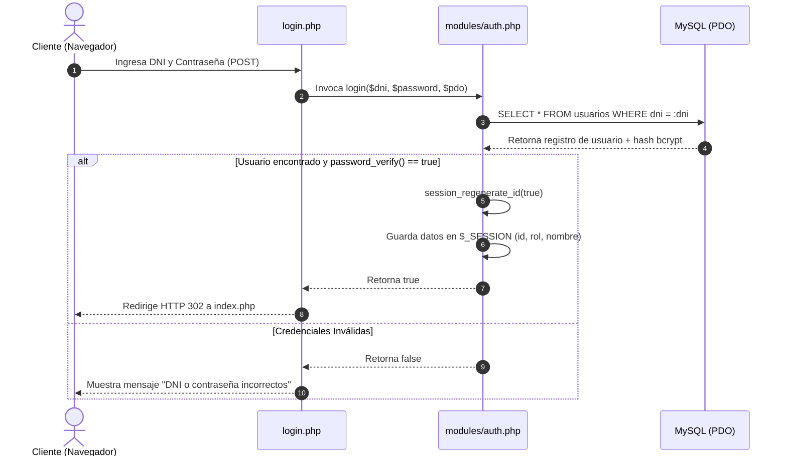

# 02. Módulo de Seguridad, Autenticación y Control de Acceso

## 🔒 Principios de Seguridad Aplicados

El sistema implementa defensas en profundidad siguiendo los estándares recomendados para aplicaciones web en PHP y MySQL:

1. **Autenticación por DNI**: El DNI (Documento Nacional de Identidad) constituye la credencial primaria de identificación única.
2. **Encriptación de Contraseñas (Hashing Strong)**: No se almacenan contraseñas en texto plano bajo ninguna circunstancia. Se utiliza el algoritmo **bcrypt** a través de las funciones nativas `password_hash($pass, PASSWORD_DEFAULT)` y `password_verify($pass, $hash)`.
3. **Protección contra Inyección SQL (SQLi)**: Todas las consultas a la base de datos utilizan **Sentencias Preparadas PDO** con binding de parámetros estricto (`PDO::ATTR_EMULATE_PREPARES => false`).
4. **Protección contra Scripting Entre Sitios (XSS)**: Todas las salidas de datos hacia el HTML son sanitizadas mediante `htmlspecialchars($str, ENT_QUOTES, 'UTF-8')`.
5. **Seguridad de Sesiones**:
   * Manejo transparente de sesiones mediante `session_start()`.
   * **Regeneración de ID de sesión**: `session_regenerate_id(true)` previene ataques de *Session Fixation* tras una autenticación exitosa.
   * **Destrucción segura de cookies**: `logout.php` limpia las variables `$_SESSION`, invalida la cookie de sesión en el cliente y destruye la sesión en el servidor.

---

## 🛡️ Matriz de Control de Acceso basado en Roles (RBAC)

La aplicación aplica restricciones de acceso en la capa del servidor mediante la verificación de `$_SESSION['rol_id']`:

| Recurso / Acción | Administrador (Rol 1) | Profesor (Rol 2) | Alumno (Rol 3) |
| :--- | :---: | :---: | :---: |
| **Iniciar / Cerrar Sesión** |  Permitido |  Permitido |  Permitido |
| **Acceso a Dashboard (`index.php`)** |  Permitido |  Permitido |  Permitido |
| **Ver Listado de Alumnos (`alumnos.php`)** |  Permitido |  Permitido | ❌ Redirige a `perfil.php` |
| **Crear Nuevo Alumno** |  Permitido |  Permitido | ❌ Denegado |
| **Editar Datos de Alumno** |  Permitido |  Permitido | ❌ Denegado |
| **Eliminar Alumno (Baja Física)** |  **Permitido** | ❌ **Denegado** | ❌ **Denegado** |
| **Autogestión de Perfil (`perfil.php`)** |  Permitido |  Permitido |  Permitido |

---

## 🔄 Flujo de Autenticación (Diagrama de Secuencia)

